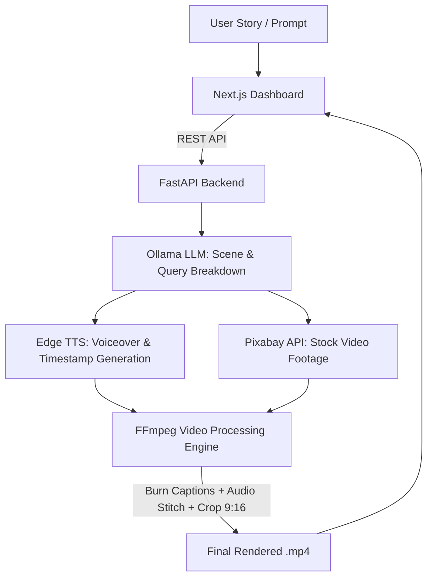

# ⚡ AutoShorts AI — Automated Short Video Generator

> Transform raw stories and prompts into fully rendered, subtitle-burned vertical videos (YouTube Shorts, Instagram Reels, TikTok) in seconds — powered by Local LLMs, Edge TTS, Pixabay, and FFmpeg.

---

## 🌟 Overview

**AutoShorts AI** is a full-stack, autonomous video production pipeline. Given a prompt or story text, it breaks down the narrative into visual beats, generates high-quality realistic voice narration with word-level subtitle timestamps, queries stock video footage, and programmatically stitches, crops, and burns captions into ready-to-post 9:16 videos.

---

## ✨ Key Features

- 🧠 **AI Script & Scene Breakdown**: Uses local LLMs (**Ollama / LLaMA 3.2**) to analyze stories into sequential visual scenes with context-aware stock queries.
- 🎙️ **Hyper-Realistic Narration**: Powered by **Edge-TTS** (`en-US-ChristopherNeural`) with word-boundary timestamp tracking.
- 🎬 **Dynamic Asset Retrieval**: Automatically queries and downloads royalty-free video clips via the **Pixabay API**.
- 📝 **Auto-Burned Synced Captions**: Generates custom ASS/SRT subtitles with highlighted styling burned directly via **FFmpeg**.
- 📐 **Multiple Aspect Ratios**: Supports `9:16` (Vertical / Shorts / Reels), `16:9` (Landscape), and `1:1` (Square).
- 🖥️ **Full-Stack Dashboard**: Modern **Next.js** web interface with authentication, video status tracking, generation history, and real-time playback.
- ⚡ **Fast & Asynchronous**: FastAPI backend with non-blocking generation jobs and SQLite/PostgreSQL persistence.

---

## 🏗️ Architecture & Pipeline



---

## 🛠️ Tech Stack

### **Frontend**
- **Framework:** [Next.js](https://nextjs.org/) (React)
- **Styling:** Tailwind CSS / Modern Dashboard UI
- **State & HTTP:** Axios / Fetch API

### **Backend & Video Engine**
- **API Framework:** [FastAPI](https://fastapi.tiangolo.com/) (Python 3.10+)
- **LLM Engine:** [Ollama](https://ollama.com/) (`llama3.2:3b` / customizable)
- **Voice Synthesis:** `edge-tts` (Microsoft Edge Neural TTS)
- **Media Processing:** [FFmpeg](https://ffmpeg.org/) (Custom subtitle styling & filter complex)
- **Stock Footage:** [Pixabay API](https://pixabay.com/api/docs/)
- **Database:** SQLAlchemy & Pydantic (User auth & creations history)

---

## 📁 Repository Structure

```text
short_video_automation/
├── nextjs-admin-panel-starter/      # Next.js web dashboard & user interface
│   ├── app/                         # App router (auth, creations, dashboard)
│   ├── components/                  # Reusable UI components
│   └── package.json
├── story_to_video_backend/          # FastAPI backend & rendering pipeline
│   ├── app/
│   │   ├── core/                    # App config & security settings
│   │   ├── models/                  # SQLAlchemy database models
│   │   ├── routes/                  # API endpoints (auth, creations)
│   │   ├── schemas/                 # Pydantic validation schemas
│   │   └── services/                # video_generator.py (pipeline engine)
│   ├── output_data/                 # Rendered video clips & audio cache
│   ├── requirements.txt
│   └── run.py
├── .gitignore
└── README.md
```

---

## 🚀 Getting Started

### 1. Prerequisites
- **Python 3.10+**
- **Node.js 18+** & `npm`
- **FFmpeg** installed and added to your system `PATH`
- **Ollama** installed with the model downloaded:
  ```bash
  ollama run llama3.2:3b
  ```

---

### 2. Backend Setup

1. Navigate to the backend directory:
   ```bash
   cd story_to_video_backend
   ```

2. Create and activate a virtual environment:
   ```bash
   # Windows
   python -m venv venv
   .\venv\Scripts\activate

   # Linux/macOS
   python3 -m venv venv
   source venv/bin/activate
   ```

3. Install dependencies:
   ```bash
   pip install -r requirements.txt
   ```

4. Create a `.env` file in `story_to_video_backend/`:
   ```env
   DATABASE_URL=sqlite:///./app.db
   SECRET_KEY=your_super_secret_jwt_key
   BACKEND_BASE_URL=http://localhost:5000
   PIXABAY_API_KEY=your_pixabay_api_key_here
   ```

5. Start the FastAPI server:
   ```bash
   python run.py
   # Runs on http://localhost:5000
   ```

---

### 3. Frontend Setup

1. Navigate to the frontend directory:
   ```bash
   cd nextjs-admin-panel-starter
   ```

2. Install dependencies:
   ```bash
   npm install
   ```

3. Run the development server:
   ```bash
   npm run dev
   # Runs on http://localhost:3000
   ```

4. Open [http://localhost:3000](http://localhost:3000) in your browser.

---

## 🎬 How It Works

1. **Submit Story**: Enter a story prompt or topic in the web UI.
2. **Director Mode**: Ollama splits the narrative into chronological scenes and identifies visual search terms.
3. **Voice & Timestamps**: Audio files and precise word boundaries are created via `edge-tts`.
4. **Footage Matching**: Background video clips matching the queries are downloaded from Pixabay.
5. **Assembly**: FFmpeg rescales the video to vertical `1080x1920`, adds a smooth loop, burns high-visibility centered subtitles, and mixes the master audio.
6. **Delivery**: The completed `.mp4` is saved and previewable directly on your dashboard.

---

## 🤝 Contributing

Contributions, issues, and feature requests are welcome! Feel free to check the issues page.

---

## 📄 License

This project is open-source and available under the [MIT License](LICENSE).
